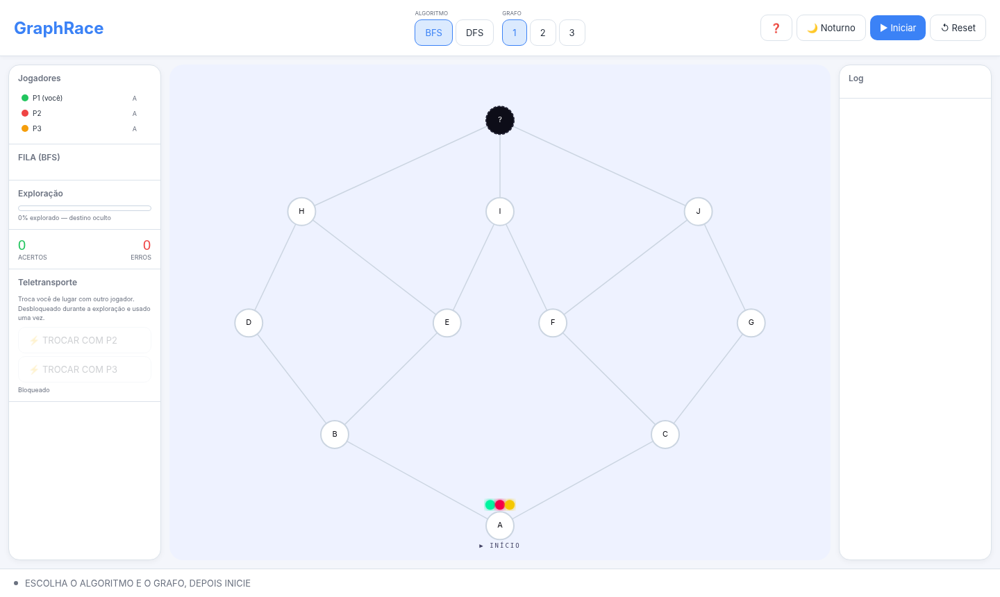

# GraphRace

**Jogo educacional digital para explorar os algoritmos de busca em largura (BFS) e em profundidade (DFS).**

No GraphRace, o estudante não apenas observa uma busca em grafos: ele **prevê o próximo nó que será expandido**, recebe feedback sobre sua escolha e utiliza os nós explorados para avançar em uma corrida contra dois adversários automatizados.

O projeto foi desenvolvido como artefato do Trabalho de Conclusão de Curso (TCC) de **José Vilmar Brito Sousa**, do curso de Engenharia de Software da **Universidade Federal do Ceará (UFC) — Campus de Russas**.



*Interface inicial do jogo, com o Grafo 1 selecionado.*

## Conteúdo

- [Objetivo e funcionalidades](#objetivo-e-funcionalidades)
- [Como jogar](#como-jogar)
- [Executar localmente](#executar-localmente)
- [Organização do projeto](#organização-do-projeto)
- [Regras e decisões de implementação](#regras-e-decisões-de-implementação)
- [Testes e validação](#testes-e-validação)
- [Publicação](#publicação)
- [Contexto acadêmico e limitações](#contexto-acadêmico-e-limitações)
- [Autoria e licença](#autoria-e-licença)

## Objetivo e funcionalidades

O GraphRace propõe uma atividade de previsão e tomada de decisão durante a execução de algoritmos de busca. Seu foco está na **ordem de exploração dos vértices** e nas diferenças entre as estruturas utilizadas por BFS (fila) e DFS (pilha).

O jogo oferece:

- **Dois algoritmos:** busca em largura (*Breadth-First Search* — BFS) e busca em profundidade (*Depth-First Search* — DFS).
- **Três grafos:** 11, 19 e 27 vértices, com dificuldade progressiva.
- **Visualização interativa:** nós e arestas em SVG, destaque dos vértices explorados, progresso e registro de eventos.
- **Previsões a cada turno:** até três alternativas de próximo vértice para o jogador humano.
- **Dois adversários:** P2 acerta as previsões; P3 acerta probabilisticamente (probabilidade de 50%).
- **Movimentação estratégica:** acertos permitem escolher movimentos válidos, enquanto erros geram um movimento desfavorável quando possível.
- **Destino inicialmente oculto:** o identificador aparece quando o destino já foi explorado e pelo menos 75% do grafo foi expandido.
- **Teletransporte:** mecanismo de troca de posições sujeito a condições de desbloqueio e uso único.
- **Tutorial e interface responsiva:** orientação inicial, abas para dispositivos móveis e alternância de tema claro/escuro.

## Como jogar

1. Selecione **BFS** ou **DFS** e um dos três grafos.
2. Clique em **Iniciar**. Os três jogadores começam no vértice inicial.
3. Quando for a vez do **P1 (você)**, escolha qual dos nós apresentados será expandido a seguir.
4. Se acertar, escolha um nó adjacente **já explorado** para se mover ou permaneça na posição atual. Se errar, o movimento é determinado pelas regras do jogo.
5. Observe os turnos de **P2** e **P3**, a evolução da busca, o log e os recursos disponíveis.
6. Continue até que o destino seja revelado e um jogador chegue primeiro a ele.

Os grafos maiores deixam de mostrar explicitamente a fila/pilha, exigindo maior atenção à lógica de execução. Quando não restam nós a expandir, a partida continua apenas com os movimentos dos jogadores.

## Executar localmente

### Requisitos

- Navegador atualizado com suporte a **JavaScript ES Modules**.
- Um servidor HTTP local simples. **Não é necessário instalar dependências ou executar um build para jogar.**

Como os scripts usam `import` e `export`, **não abra o `index.html` diretamente com `file://`**. Execute os arquivos por HTTP.

**Opção 1 — Python:**

```bash
python -m http.server 8000
```

Acesse **http://localhost:8000** no navegador.

**Opção 2 — Node.js:**

```bash
npx serve .
```

**Opção 3 — VS Code:** abra a pasta do projeto e use a extensão **Live Server** no `index.html`.

> O Node.js é necessário apenas para executar os testes automatizados ou para usar um servidor local baseado em Node. A versão publicada do jogo é estática.

## Organização do projeto

```text
GraphRace/
├── index.html              # Marcação da interface e ponto de entrada da página
├── css/
│   └── styles.css          # Estilos, temas e adaptações responsivas
├── js/
│   ├── 01-graph-data.js    # Definição dos três grafos
│   ├── 02-state.js         # Estado central da partida e temporizadores seguros
│   ├── 03-graph-setup.js   # Carregamento dos grafos e distâncias
│   ├── 04-render.js        # Desenho dos grafos e dos jogadores em SVG
│   ├── 05-algorithm.js     # Expansão BFS/DFS e revelação do destino
│   ├── 06-movement.js      # Cálculo dos movimentos e alternativas
│   ├── 07-teleport.js      # Regras de teletransporte
│   ├── 08-turns.js         # Controle dos turnos e fluxo da partida
│   ├── 09-visuals.js       # Feedback, progresso, destaques e log
│   ├── 10-lifecycle.js    # Reinicialização e encerramento
│   ├── 11-ui-layout.js    # Layout responsivo e temas
│   ├── 12-tutorial.js     # Tutorial guiado
│   └── main.js            # Ponto de entrada dos módulos ES
├── assets/
│   └── preview.png         # Captura ilustrativa para o README
├── test/                   # Testes automatizados e ambiente DOM de teste
├── .github/workflows/
│   └── tests.yml           # Execução dos testes no GitHub Actions
├── .editorconfig
├── .gitignore
├── package.json            # Dependências usadas somente em desenvolvimento/testes
├── package-lock.json
├── vitest.config.js
└── README.md
```

### Organização arquitetural

A aplicação é uma **página web estática organizada em módulos ES**, sem framework de interface, back-end ou banco de dados. A separação dos arquivos é funcional: dados, estado, busca, regras de partida, apresentação e inicialização.

O objeto `state`, em `02-state.js`, centraliza as posições dos jogadores, os nós explorados/visitados, a fila/pilha, a etapa do jogo e os indicadores de uso do teletransporte. A orquestração ocorre predominantemente em `08-turns.js`, enquanto os módulos de renderização e interface atualizam o DOM e o SVG.

O projeto não implementa uma arquitetura em camadas rígida ou *Clean Architecture*: algumas regras de negócio também acionam efeitos visuais, e há dependências circulares entre módulos de interface, controle e ciclo de vida. Essa é uma **limitação de manutenção conhecida**, que não impede a execução da aplicação e pode orientar refatorações futuras.

### Tecnologias

| Tecnologia | Uso |
| --- | --- |
| HTML5 | Estrutura e elementos da interface |
| CSS3 | Estilos, temas e responsividade |
| JavaScript (ES Modules) | Regras do jogo e interação |
| SVG | Representação interativa dos grafos |
| `localStorage` | Preferências locais de tema e exibição do tutorial |
| Vitest + jsdom | Testes automatizados das regras e do DOM |

O jogo não utiliza autenticação, API remota ou armazenamento de respostas dos jogadores. O uso de `localStorage` limita-se às preferências de interface indicadas acima.

## Regras e decisões de implementação

### BFS e DFS

A BFS utiliza uma **fila (FIFO)** e explora o grafo por níveis. A DFS utiliza uma **pilha (LIFO)** e aprofunda os caminhos antes de retornar. A implementação ordena alfabeticamente os vizinhos ao construir as estruturas de busca para tornar o desempate reprodutível.

Os conjuntos de vértices **visitados** e **explorados** têm papéis diferentes: um vértice visitado já entrou na estrutura de busca, enquanto um explorado já foi efetivamente expandido.

### Apoio visual progressivo

O **Grafo 1** apresenta a estrutura de busca (fila ou pilha) como apoio. Nos **Grafos 2 e 3**, essa estrutura não é exibida, incentivando o jogador a prever os próximos passos sem a mesma pista visual.

### Movimento e adversários

Os jogadores só podem se mover para vértices adjacentes já explorados. As escolhas automatizadas de movimento usam a distância, em número de arestas, até o destino: a melhor opção aproxima o jogador e a pior opção tende a afastá-lo. O P2 acerta seus palpites; o P3 possui probabilidade de 50% de acerto.

### Revelação do destino e teletransporte

O destino começa com o rótulo `?`. A revelação ocorre quando **ambas as condições** são atendidas: o destino já foi expandido e a exploração atingiu pelo menos **75%** dos vértices. A expansão isolada do destino não deve antecipar seu identificador no rótulo do grafo.

O teletransporte do P1 é desbloqueado em situações definidas pela progressão da busca: na BFS, ao concluir uma camada; na DFS, a cada três expansões. Pode ser usado **uma vez por partida**, durante a janela válida de movimento. O P3 possui um teletransporte automático de uso único, que pode ocorrer após **90% de exploração**, nas condições previstas para seu turno.

### Reinício seguro

As continuações de turnos agendadas utilizam `safeTimeout()`, que confere um identificador de sessão (`gameEpoch`). Ao reiniciar a partida, os temporizadores de partidas anteriores deixam de executar operações sobre a nova sessão. O reset também descarta o callback de movimento pendente.

## Testes e validação

A suíte automatizada usa **Vitest** com **jsdom** e cobre, entre outros pontos:

- comportamento e ordem de expansão de BFS e DFS;
- integridade e conectividade dos três grafos;
- progresso de exploração e condição de revelação do destino;
- movimentos permitidos e alternativas de palpite;
- reinicialização do estado e cancelamento lógico de temporizadores antigos;
- condições de desbloqueio e uso do teletransporte automático.

Para executar, instale **Node.js 22.13 ou superior** (ou uma versão compatível indicada no `package.json`) e rode:

```bash
npm ci
npm test
```

Para acompanhar os testes durante o desenvolvimento:

```bash
npm run test:watch
```

As dependências são **apenas de desenvolvimento**, não fazem parte dos arquivos necessários para hospedar o jogo. O fluxo `.github/workflows/tests.yml` também está configurado para executar `npm ci` e `npm test` em *pushes* e *pull requests* no GitHub.

Os testes automatizados verificam uma parte das regras e da manipulação do DOM; **não equivalem a uma validação completa da experiência visual, acessibilidade ou usabilidade**. Essas dimensões exigem verificações adicionais em navegadores e dispositivos reais.

## Publicação

O GraphRace pode ser hospedado em um serviço de **arquivos estáticos**.

**GitHub Pages:** envie os arquivos para um repositório e, nas configurações de **Pages**, escolha a publicação a partir da branch principal e da pasta raiz (`/`). O arquivo `index.html` é o ponto de entrada.

**Netlify:** importe o repositório ou envie a pasta do projeto para um deploy manual. Não há comando de build; publique a **raiz do projeto**.

O `node_modules/`, os resultados de cobertura e arquivos locais são excluídos pelo `.gitignore`. O `package-lock.json` deve permanecer versionado para garantir instalações de teste reprodutíveis.

## Contexto acadêmico e limitações

Este jogo é um **artefato de pesquisa** voltado ao uso de contextos alternativos e interação na abordagem de algoritmos de busca em grafos. Sua proposta é oferecer apoio complementar ao ensino e à revisão de BFS e DFS; **a existência do software não constitui, por si só, evidência de eficácia pedagógica ou de aprendizagem causada pelo jogo**.

O código foi desenvolvido para uso em navegador e para um experimento educacional com fluxo de partida individual. Não há persistência de progresso entre partidas, multiplayer em rede, sistema de contas ou painel de análise de respostas. A arquitetura privilegia simplicidade de distribuição, com algumas dependências entre módulos que podem ser reduzidas em uma evolução posterior.

## Autoria e licença

**José Vilmar Brito Sousa** — Engenharia de Software, Universidade Federal do Ceará (UFC), Campus de Russas.

**Licença:** ainda não foi escolhida uma licença de software para este repositório. Na ausência de uma licença explícita, o código **não está automaticamente autorizado para cópia, modificação ou redistribuição por terceiros**. Para reutilizá-lo, solicite autorização ao autor.
